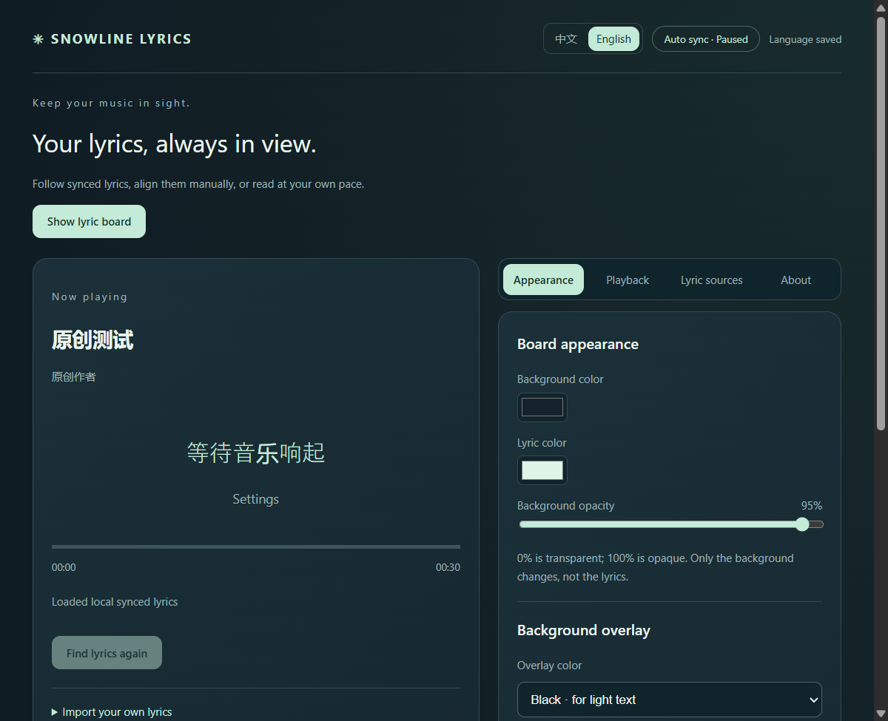

# Snowline Lyrics

**English** | [简体中文](README.zh-CN.md)

A floating lyric board for Windows, built with Rust and Tauri 2. It reads system media sessions and displays synchronized or plain lyrics in an always-on-top window.

## Download and run

1. Download `Snowline-Lyrics-0.6.0-win-x64.zip` from [Releases](https://github.com/Juliet0701/snowline-lyrics/releases) and extract the complete archive.
2. Quit the previous version from its tray menu, then open `SnowlineLyrics.exe`.
3. Play a song in your music app. Open **Settings** to select a player, confirm a lyric version, or customize the board.

Requires Windows 10/11 x64 and Microsoft Edge WebView2 Runtime. You do not need Node.js, Rust, a browser extension, a music-account login or an API key to use the portable application. This is an unsigned preview; Windows 11 has been tested, while Windows 10 and every third-party player have not been individually verified.

## Switch the interface language

Click **中文** or **English** at the top of the settings window. Your choice is saved, and the lyric board, window title and tray menu follow it. There is no extra language button on the board.

On first use, a Chinese system language selects Simplified Chinese; other languages default to English. **Song titles, artist names and lyric text are never translated.** This release retains the window dimensions, typography and dragging behavior of version 0.5.1.



## Reading modes

| Mode | When to use it | How it works |
| --- | --- | --- |
| Automatic sync | Your player supplies a timeline and the lyrics have timestamps | Follows playback, pause and seeking |
| Manual alignment | The song is known, but the player supplies no useful timeline | Select the current line in settings and start the independent lyric clock |
| Full lyrics | Only plain text is available | Scroll through the lyrics on the board or in settings |

Manual alignment never controls music playback. If the player reports reliable pause status, the clock follows it. Otherwise, pause the lyric clock when pausing your music. After seeking, choose a line again; timing may drift during long playback. A song/source change or changed lyrics clears manual alignment.

You can import your own UTF-8 `.lrc` or `.txt` file for the current song. Imported files and cached matches stay on your device. Plain text is not converted into fabricated timestamped lyrics.

## Controls and appearance

- Use **↻** on the board to search again. Current imported or confirmed lyrics are preserved while alternatives are searched.
- Drag the board to move it, resize it at the edges, and toggle **Pin** to keep it on top.
- Customize the background color, image and opacity, lyric color, black/white overlay and text shadow in settings.
- Images are resized locally, centered and cropped to fill. Overlay and background opacity are separate controls.
- Closing the board hides it; restore it from the tray menu. Closing settings releases that window. Quit from the tray menu.

## Lyric sources

**LRCLIB** is enabled by default. It provides timestamped and plain lyrics. Confident matches can load automatically; uncertain versions require confirmation.

**LrcApi** is an optional, free public synced-lyric source at `https://api.lrc.cx/jsonapi`, off by default. If LRCLIB has no confident synced match, it receives the title and artist. Its candidates always need confirmation. Only directly returned lyric text is used; returned file paths and artwork links are not followed.

**lyrics.ovh** is an optional plain-text fallback, also off by default. It receives the title and artist only when earlier sources have no usable result. Select a version to read the returned text.

Public services may be slow, rate-limited, unavailable or inaccurate. Coverage is not guaranteed. Live, cover and edited recordings may not match. A public endpoint or open-source server license does not grant rights to lyric content. See [third-party notices](THIRD-PARTY-NOTICES.md).

## Privacy and upgrades

The application reads Windows media metadata and available playback progress. It does not record audio, use the microphone, read music-account credentials or cookies, or collect telemetry. Network lyric requests send only the required title, artist and optional duration. Your local images, imported files and cache files are not uploaded. See [PRIVACY.md](PRIVACY.md).

The Rust edition stores data in `%APPDATA%/SnowlineLyricsRust`. On first use it can copy known settings from the old `%APPDATA%/SnowlineLyrics` profile without modifying the original. Language selection is saved in `settings.json`. Keep your previous release and profile if you need rollback.

The runtime uses system WebView2, with Rust handling media access, lyric queries and persistence through local Tauri commands. It does not bundle Electron or run a Node HTTP server or C# media helper. A smaller download does not imply a proportional reduction in RAM use.

## Development

Use Rust 1.99.1 or a compatible newer MSVC toolchain, Windows SDK and WebView2. Node.js 22+ is needed for development scripts, packaging and desktop automation only.

```powershell
npm ci
npm test
npm run check
npm run audit:source
npm run build
node scripts/rust-desktop-check.mjs src-tauri/target/release/snowline-desktop.exe
npm run package:windows
```

Interface text is centralized in `web/translations.mjs` and applied by `web/i18n.mjs`. Translate interface messages only: never pass lyric text, song metadata, imported filenames or candidate titles through the translator. See [verification records](docs/VERIFICATION.md) and [contributing](CONTRIBUTING.md).

## License

Project code and documentation are MIT licensed. Lyrics, recordings, artist information and third-party software retain their respective rights. Do not commit real lyrics, music, local profiles or credentials to public repositories. The project is not affiliated with or endorsed by Microsoft, YouTube, Google or the lyric providers.
