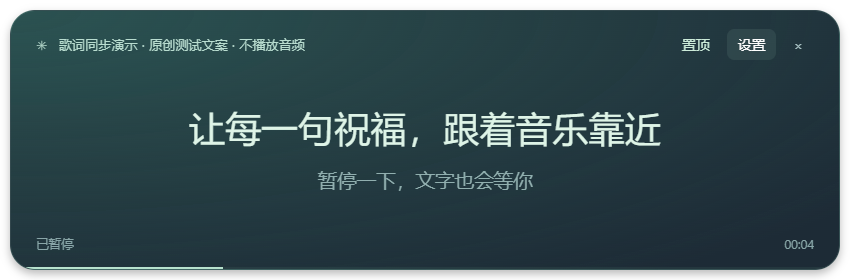

# Snowline Lyrics

A floating lyric board for Windows. System media sessions → timestamped lyrics → a quiet desktop overlay.

一块独立的桌面歌词板：读取 Windows 播放器信息，自动查找同步歌词，无需浏览器扩展或 DeepSeek Harness。



## 使用

1. 下载发布页提供的 `Snowline-Lyrics-0.1.0-win-x64.zip` 便携包，完整解压。
2. 双击 `SnowlineLyrics.exe`，在音乐软件中播放歌曲。
3. 拖动歌词板顶部移动窗口，拖动边缘调整大小；可切换置顶。点击“设置”可选择播放器、确认歌词版本、调整时间偏移或导入自己的 `.lrc`。

点击 × 会隐藏歌词板。双击托盘图标恢复；右键托盘选择“退出”。不需要 Node、音乐账号登录、API Key 或浏览器扩展。

当前是未签名的 Windows x64 测试版，没有自动更新。首次查歌词需要联网，已匹配歌词缓存在本机。源代码下载包不含 Electron 或编译后的 exe，普通用户应选择便携发布包。

## 功能与实际支持范围

- 通过 Windows 系统媒体会话读取歌曲、歌手、播放/暂停状态和进度。
- 从 [LRCLIB](https://lrclib.net) 查找带时间戳的歌词；匹配明确时自动加载，多版本或低置信度时由用户确认。
- 播放、暂停和进度跳转同步，支持歌词时间偏移与本地 LRC 导入。
- 独立歌词板、托盘控制、窗口位置和置顶状态保存。

需要 Windows 10/11 x64、.NET Framework 4.8，以及提供有效系统媒体进度的播放器。已在 Windows 11 验证 YouTube Music Chrome PWA；其他播放器和 Windows 10 尚未逐一验证，不能保证所有软件都可用。多个会话同时播放时，可在设置中指定来源。

本项目不录音、不调用麦克风、不含音频指纹识曲。没有歌词或进度时会明确提示。无时间戳的普通歌词不会自动变为逐句同步歌词；现场、翻唱、不同剪辑版本可能无法匹配。

## 隐私、歌词与第三方

自动歌词查询会向 LRCLIB 发送歌名、歌手和时长，以及普通 HTTPS 连接信息。不会读取音乐账号、Cookies、播放列表或音频内容。详情见 [PRIVACY.md](PRIVACY.md)。

**MIT 许可证仅适用于本仓库自有代码和文档。歌词、歌曲、艺人信息及第三方软件的权利不因此转移。** 仓库不捆绑真实歌曲歌词或音乐文件；用户应遵守适用的内容权利及服务规则，勿将下载的歌词缓存提交到公开仓库。

本项目与 YouTube、Google、Microsoft、LRCLIB、DeepSeek 或 dsh-pet 的权利人没有隶属或官方背书关系。产品及公司名称属于各自权利人。第三方运行时及开发依赖见 [THIRD-PARTY-NOTICES.md](THIRD-PARTY-NOTICES.md)。

## 本地开发

需要 Node.js 22+、PowerShell 7、.NET Framework 4.8 的编译器/引用，以及 Windows 10/11 SDK（UnionMetadata）。这些是开发要求，便携版用户无需安装 SDK 或 Node。

```powershell
npm ci
npm run build:native
npm test
npm run check
npm run audit:source
npm start
```

打包：

```powershell
npm run package:windows
Compress-Archive -LiteralPath dist/Snowline-Lyrics-0.1.0-win-x64 -DestinationPath dist/Snowline-Lyrics-0.1.0-win-x64.zip
```

输出目录存在时打包脚本会停止；请先检查并移动旧构建，或提升版本号。脚本可接收现有官方 Electron 43.3.0 运行时目录作为参数。运行时自带许可证会保留；构建不会带入个人缓存。

默认数据目录：`%APPDATA%/SnowlineLyrics`。开发测试数据、日志、依赖、编译产物和发布包均不应提交到 Git，已在 `.gitignore` 排除。

## 开源与发布

自有代码采用 [MIT](LICENSE)。开发贡献、漏洞报告及发布步骤分别见 [CONTRIBUTING.md](CONTRIBUTING.md)、[SECURITY.md](SECURITY.md) 和 [GitHub 发布指南](docs/PUBLISHING.md)。本仓库包含仅验证与打包的 GitHub Actions，不会自动公开发布版本。

这是从独立歌词原型抽取出的纯歌词板项目，不包含 dsh-pet 的源码、人物素材、动画或配置。开发时使用了 AI 编程辅助；功能、依赖和发布内容仍需维护者审核。
