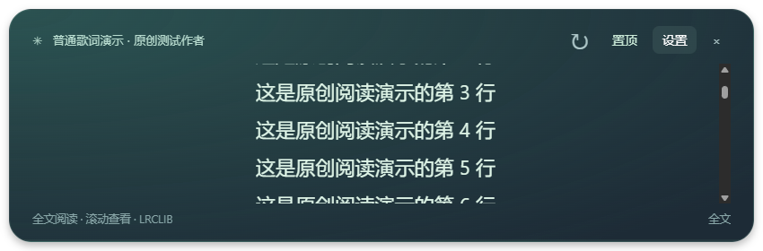

# Snowline Lyrics

A floating lyric board for Windows. System media sessions → timestamped lyrics → a quiet desktop overlay.

一款独立的 Windows 桌面歌词应用：读取播放器信息，自动查找同步歌词，以可拖动、可置顶的歌词板显示。


## 使用

1. 从 [Releases](https://github.com/Juliet0701/snowline-lyrics/releases) 下载 `Snowline-Lyrics-0.3.0-win-x64.zip` 便携包，完整解压。
2. 双击 `SnowlineLyrics.exe`，在音乐软件中播放歌曲。
3. 拖动歌词板顶部移动窗口，拖动边缘调整大小；可切换置顶。点击“设置”可选择播放器、确认歌词版本、调整时间偏移或导入自己的 `.lrc`。

顶部 **↻** 位于置顶按钮左侧，直接重新查找当前歌曲的歌词。查询时按钮会暂时禁用；服务要求等待时会显示原因。重查保留当前歌词，用户已导入或选定的版本不会被静默覆盖。

## 三种阅读方式

| 模式 | 适用情况 | 操作 |
| --- | --- | --- |
| 自动同步 | 播放器提供有效进度，歌词带时间戳 | 跟随播放器播放、暂停和跳转 |
| 手动对齐 | 有歌名和时间戳歌词，但没有有效进度 | 在设置中点选当前句，点击“从选中句开始对齐” |
| 全文阅读 | 歌词只有普通文本 | 在歌词板或设置中手动滚动查看全文 |

手动对齐仅启动独立歌词计时，不会启动或控制音乐播放。播放器提供可靠暂停状态时跟随暂停；状态未知时，请同时使用“暂停/继续歌词计时”。音乐拖动进度后需要重新选句，长时间播放也可能产生偏差。换歌、切换播放器、歌词变更或断连会清除对齐；恢复有效系统进度后自动使用系统同步。

无时长或版本信息不足时，先确认候选版本再对齐。QQ 音乐等客户端是否能读取歌名和暂停状态仍取决于实际版本，本版的无进度模式已用模拟会话测试，不代表已实机验证每个客户端。

## 歌词来源

### 第二同步源：LrcApi（免费、免账号）

0.3.0 新增 [LrcApi 公共接口](https://github.com/HisAtri/LrcApi#使用方法)。在设置中开启 **允许 LrcApi 公共同步源**，再点击歌词板上的 ↻。

当 LRCLIB 没有明确匹配的时间戳歌词（包括只找到普通歌词）或请求失败时，程序会查询 `https://api.lrc.cx/jsonapi`。只发送歌名、歌手，不需要账号、API Key、付费订阅或自己部署服务器。只接受直接返回的有效 LRC，保留服务返回的歌曲、歌手和专辑信息，不跟随其中的图片或文件链接。

该来源默认关闭，开启后自动参与后续查找。公共服务可能较慢、不准确、限流、失效或改变接入要求；遇到这些情况会提示并保留可用歌词，不会转入付费服务。它提供的候选始终需要用户确认版本，确认后有系统进度则自动同步，无进度则可点选句子手动对齐。

公开服务会聚合其他音乐来源，不是本项目拥有或保证已获歌词展示授权的数据库。服务端开源许可证与歌词内容权利不同；本项目仅调用公开 HTTP 接口，未捆绑服务端代码、标志、歌词数据库或真实歌词。详见 [第三方说明](THIRD-PARTY-NOTICES.md)。

查找顺序为：**LRCLIB → 可选 LrcApi 同步候选 → 可选 lyrics.ovh 普通歌词**。如果已经有可用的普通歌词，也不会因此跳过第二同步源。已手动选定或导入的歌词会保留，切换候选需要确认。

默认查询 [LRCLIB](https://lrclib.net)，优先时间戳歌词，也接受普通歌词。没有可用结果或服务失败时，可在设置中开启 **lyrics.ovh 备用查询**，然后点击 ↻ 重查。

备用服务默认关闭。开启后，它会收到歌名和歌手；返回结果标注来源，并需用户确认后进入全文阅读。lyrics.ovh 自身会聚合 LRCLIB 和其他歌词站点，不是完全独立的授权歌词库。一次实际 API 查询已成功，不保证歌曲覆盖、长期可用性或内容授权；未集成其服务端代码，也不批量抓取歌词。

手动对齐预览（原创测试文案）：


全文阅读预览（原创测试文案）：



点击 × 会隐藏歌词板。双击托盘图标恢复；右键托盘选择“退出”。不需要 Node、音乐账号登录、API Key 或浏览器扩展。

当前是未签名的 Windows x64 测试版，没有自动更新。首次查歌词需要联网，已匹配歌词缓存在本机。源代码下载包不含 Electron 或编译后的 exe，普通用户应选择便携发布包。

## 功能与实际支持范围

- 通过 Windows 系统媒体会话读取歌曲、歌手、播放/暂停状态和进度。
- 从 [LRCLIB](https://lrclib.net) 查找时间戳和普通歌词；匹配明确时自动加载，多版本或低置信度时由用户确认。
- 播放、暂停和进度跳转同步，支持歌词时间偏移与本地 LRC 导入。
- 独立歌词板、托盘控制、窗口位置和置顶状态保存。

需要 Windows 10/11 x64、.NET Framework 4.8，以及至少向系统提供歌名的播放器。自动同步还要求有效系统进度。已在 Windows 11 验证 YouTube Music Chrome PWA；其他播放器和 Windows 10 尚未逐一验证，不能保证所有软件都可用。多个会话同时播放时，可在设置中指定来源。

本项目不录音、不调用麦克风、不含音频指纹识曲。没有歌词或进度时会明确提示。无时间戳的普通歌词不会自动变为逐句同步歌词；现场、翻唱、不同剪辑版本可能无法匹配。

## 隐私、歌词与第三方

自动歌词查询会向 LRCLIB 发送歌名、歌手和时长，以及普通 HTTPS 连接信息。不会读取音乐账号、Cookies、播放列表或音频内容。详情见 [PRIVACY.md](PRIVACY.md)。

仅在开启备用查询后才向 lyrics.ovh 发送歌名和歌手。自己的 UTF-8 `.lrc` 或 `.txt` 文件也可导入，绑定当前歌曲，仅存本机。

**MIT 许可证仅适用于本仓库自有代码和文档。歌词、歌曲、艺人信息及第三方软件的权利不因此转移。** 仓库不捆绑真实歌曲歌词或音乐文件；用户应遵守适用的内容权利及服务规则，勿将下载的歌词缓存提交到公开仓库。

本项目与 YouTube、Google、Microsoft 或 LRCLIB 没有隶属或官方背书关系。产品及公司名称属于各自权利人。第三方运行时及开发依赖见 [THIRD-PARTY-NOTICES.md](THIRD-PARTY-NOTICES.md)。

## 本地开发

需要 Node.js 22+、PowerShell 7、.NET Framework 4.8 的编译器/引用，以及 Windows 10/11 SDK（UnionMetadata）。这些是开发要求，便携版用户无需安装 SDK 或 Node。

```powershell
npm ci
npm run build:native
npm test
npm run check
npm run audit:source
npm start
```

打包：

```powershell
npm run package:windows
Compress-Archive -LiteralPath dist/Snowline-Lyrics-0.3.0-win-x64 -DestinationPath dist/Snowline-Lyrics-0.3.0-win-x64.zip
```

输出目录存在时打包脚本会停止；请先检查并移动旧构建，或提升版本号。脚本可接收现有官方 Electron 43.3.0 运行时目录作为参数。运行时自带许可证会保留；构建不会带入个人缓存。

默认数据目录：`%APPDATA%/SnowlineLyrics`。开发测试数据、日志、依赖、编译产物和发布包均不应提交到 Git，已在 `.gitignore` 排除。

## 开源与发布

自有代码采用 [MIT](LICENSE)。开发贡献、漏洞报告及发布步骤分别见 [CONTRIBUTING.md](CONTRIBUTING.md)、[SECURITY.md](SECURITY.md) 和 [GitHub 发布指南](docs/PUBLISHING.md)。本仓库包含仅验证与打包的 GitHub Actions，不会自动公开发布版本。

项目仓库：[Juliet0701/snowline-lyrics](https://github.com/Juliet0701/snowline-lyrics)。开发时使用了 AI 编程辅助；功能、依赖和发布内容仍需维护者审核。
