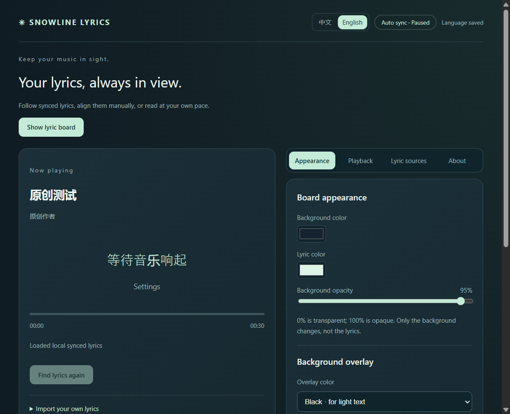

[English](README.md) | **简体中文**

# Snowline Lyrics

一款 Windows 桌面歌词板，使用 Rust + Tauri 2 构建。读取系统播放器信息，以可拖动、可置顶的窗口显示同步歌词或普通歌词。

## 下载与运行

1. 从 [Releases](https://github.com/Juliet0701/snowline-lyrics/releases) 下载 `Snowline-Lyrics-0.6.0-win-x64.zip`，完整解压。
2. 先从托盘退出旧版本，再运行 `SnowlineLyrics.exe`。
3. 在音乐软件播放歌曲，打开设置选择播放器、确认歌词版本或调整外观。

要求 Windows 10/11 x64 和 Microsoft Edge WebView2 Runtime。便携版无需安装 Node.js、Rust、浏览器扩展，也无需音乐账号授权或 API Key。当前为未签名预览版，已测试 Windows 11，尚未逐一验证 Windows 10 和所有播放器。

## 一键切换界面语言

在设置板顶部点击 **中文** 或 **English**。选择自动保存，歌词板、设置窗口标题和托盘菜单随之切换；歌词板上不增加语言按钮。

首次使用时，中文系统语言默认选择简体中文，其他语言默认英文。**歌名、歌手、歌词原文和导入的文件名不会被翻译。** 切换语言不重新查询歌词，也不重置手动计时。

本版以 0.5.1 为基础，保留该版的窗口大小、字号、样式和拖动行为。



## 三种阅读方式

| 模式 | 适用情况 | 操作 |
| --- | --- | --- |
| 自动同步 | 播放器提供有效进度，歌词带时间戳 | 跟随播放、暂停和跳转 |
| 手动对齐 | 有歌名和时间戳歌词，但没有有效进度 | 在设置里选中当前唱到的句子，再启动独立歌词计时 |
| 全文阅读 | 只有普通歌词 | 在歌词板或设置板中滚动阅读 |

手动对齐不会控制音乐软件播放。系统提供可靠暂停状态时会跟随暂停；否则请同时暂停歌词计时。音乐跳转后需要重新选句，长时间播放可能产生偏差。换歌、切换播放器或更换歌词时会清除手动对齐。

可以导入自己的 UTF-8 `.lrc` 或 `.txt` 文件并绑定当前歌曲。导入文件和匹配缓存只保存在本机。无时间戳的普通歌词不会被虚构成逐句同步歌词。

## 控制与外观

- 顶部 **↻** 重新查找歌词；查询期间保留已导入或已确认的当前歌词。
- 拖动歌词板移动窗口，在边缘调整大小；“置顶”控制是否保持在其他窗口前方。
- 设置里可以调整背景颜色、图片、透明度、歌词颜色、黑白遮罩和文字阴影。
- 背景图片在本机缩小后保存，居中裁切填满；遮罩强度和背景透明度分别控制。
- 关闭歌词板会隐藏窗口；从托盘菜单恢复或退出程序。关闭设置板会释放该窗口。

## 歌词来源

默认启用 **LRCLIB**，支持时间戳和普通歌词。明确匹配时可以自动加载，低置信度或多版本时需要确认。

**LrcApi** 是可选的同步歌词备用来源，默认关闭。LRCLIB 没有明确同步匹配时，向 `https://api.lrc.cx/jsonapi` 发送歌名和歌手。该公共来源免账号，候选版本始终需要确认。程序只接受直接返回的歌词文本，不跟随返回的文件路径或图片链接。

**lyrics.ovh** 是可选的普通歌词备用来源，也默认关闭。前面的来源没有可用结果时才发送歌名、歌手；选择版本后滚动阅读。

公共服务可能较慢、限流、不可用或匹配错误，歌曲覆盖没有保证。现场、翻唱和剪辑版本可能无法匹配。公开接口或服务端开源许可不等于歌词内容授权。详见 [第三方说明](THIRD-PARTY-NOTICES.md)。

## 隐私、升级与回退

程序只读获取 Windows 系统媒体信息，不录音、不使用麦克风、不读取音乐账号或 Cookies、不采集遥测。歌词网络查询只发送必要的歌名、歌手和可用时的时长；不会上传本地图片、歌词文件或缓存文件。详见 [隐私说明](PRIVACY.md)。

Rust 版的数据保存在 `%APPDATA%/SnowlineLyricsRust`。首次运行可以只读复制旧 `%APPDATA%/SnowlineLyrics` 中的已知配置，旧目录不被修改。语言选择保存在 `settings.json`。建议保留旧版程序和配置以便回退。

界面使用系统 WebView2，通过本地 Tauri 命令调用 Rust 服务；不捆绑 Electron，也不运行 Node HTTP 服务或 C# 媒体组件。下载体积缩小不代表相同比例的内存下降。

## 本地开发

需要 Rust 1.99.1 或兼容的更新 MSVC 工具链、Windows SDK 和 WebView2。Node.js 22+ 仅用于开发检查、打包和桌面自动化脚本。

```powershell
npm ci
npm test
npm run check
npm run audit:source
npm run build
node scripts/rust-desktop-check.mjs src-tauri/target/release/snowline-desktop.exe
npm run package:windows
```

界面文案集中在 `web/translations.mjs`，由 `web/i18n.mjs` 应用。只翻译界面消息，不要把歌词、歌曲信息、文件名和候选歌曲标题传给翻译函数。参阅 [验证记录](docs/VERIFICATION.md) 和 [贡献说明](CONTRIBUTING.md)。

## 许可

本项目自有代码和文档采用 MIT 许可。歌词、录音、艺人信息及第三方软件有各自的权利。不要将真实歌词、音乐、用户配置或凭据提交到公开仓库。本项目与 Microsoft、YouTube、Google 或歌词服务没有隶属或官方背书关系。
